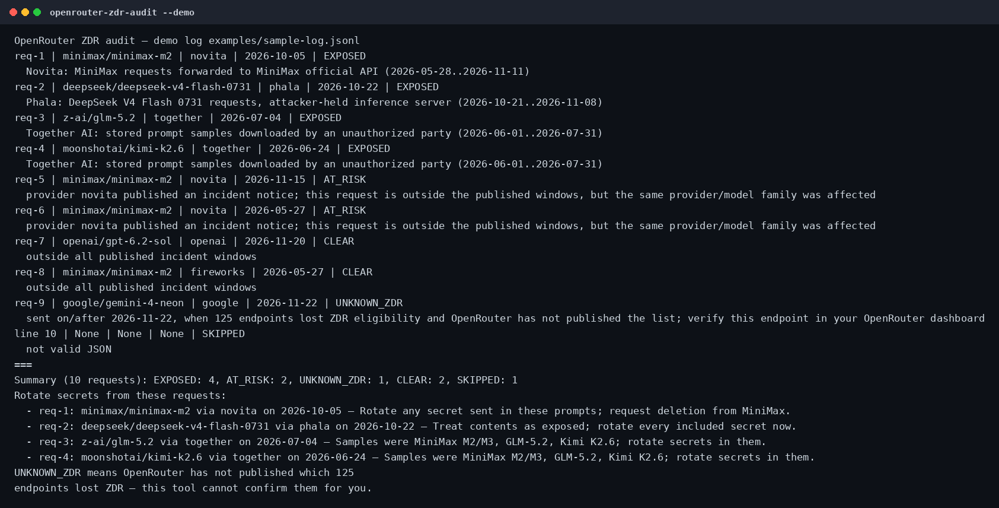

# openrouter-zdr-audit



**OpenRouter just pulled 125 endpoints off Zero Data Retention — but it hasn't published which ones. This tool checks your own request log against the three incident windows that *are* public, and tells you exactly which prompts to treat as exposed, in 0.05 seconds.**

A stdlib-only Python CLI. No installs, no network calls, no API key — it reads only the JSONL file you hand it, and nothing leaves your machine.

## Why now

On **2026-11-22**, OpenRouter announced it had **off-boarded three providers** and **removed 125 endpoints from Zero Data Retention (ZDR) eligibility**, after researchers (Dragos / HD Moore, ~2 million canary prompts seeded July–November 2026) showed customer prompts were copied, stored, or read at some providers. OpenRouter itself was not breached, and all potentially affected customers were notified.

What the record actually says — and what this tool checks:

| Provider | What happened | Exposure window |
|---|---|---|
| **Novita** | A routing fault sent some MiniMax requests to MiniMax's official API | 2026-05-28 – 2026-11-11 |
| **Phala** | An attacker controlled an inference server and could view request data in flight | 2026-10-21 – 2026-11-08 (DeepSeek V4 Flash 0731) |
| **Together AI** | Stored prompt samples (MiniMax M2/M3, GLM-5.2, Kimi K2.6, June–July) were downloaded by an unauthorized party after a coding agent leaked a credential | 2026-06-01 – 2026-07-31 |

Two things this tool refuses to pretend:

- **The three off-boarded providers were not named publicly.** OpenRouter's announcement links the Novita, Phala, and Together AI notices but does not identify them as the three. This tool checks the three *published incident windows* only — it never claims Novita/Phala/Together are the off-boarded three.
- **The 125 endpoints are not public either.** Any request sent on or after 2026-11-22 gets `UNKNOWN_ZDR`, not a false `CLEAR` — you have to verify that endpoint in your OpenRouter dashboard.

Sources: [OpenRouter incident announcement, 2026-11-22](https://openrouter.ai/blog/announcements/data-processing-incidents-on-inference-providers/) · [The Hacker News, 2026-11-22](http://thehackernews.com/2026/11/openrouter-drops-3-providers-after.html) · [Unite.AI, 2026-11-22](https://www.unite.ai/openrouter-cuts-three-providers-after-ai-prompt-exposure-findings/)

## Before / after

| | Before | After |
|---|---|---|
| What you know | "Something happened at OpenRouter — was I affected?" | `EXPOSED: 4` — req-1 to req-4, with the exact window and what to rotate |
| Time to answer | Read three incident notices, cross-check your logs by hand | **0.047 s** median (7 runs, measured 2026-11-22 on this machine) |
| False comfort | "My provider wasn't named, so I'm fine" | `UNKNOWN_ZDR` for post-2026-11-22 requests — the tool says what it cannot confirm |

## Quick start (30 seconds)

```bash
git clone https://github.com/Mahgal/openrouter-zdr-audit.git
cd openrouter-zdr-audit
python3 openrouter_zdr_audit.py --demo        # bundled sample log: 10 requests, all 5 verdicts
```

Export your own activity as JSONL — one request per line, `{"model": ..., "provider": ..., "date": "YYYY-MM-DD", "id": ...}` — then:

```bash
python3 openrouter_zdr_audit.py --log my-requests.jsonl
echo '{"model": "minimax/minimax-m2", "provider": "novita", "date": "2026-10-05"}' | python3 openrouter_zdr_audit.py
python3 openrouter_zdr_audit.py --demo --json          # machine-readable output for CI
python3 openrouter_zdr_audit.py --demo --fail-on never  # report only, always exit 0
```

No pip installs, no dependencies. Python 3.8+ only. Exit code 1 means the log contains `EXPOSED`, `AT_RISK`, or `UNKNOWN_ZDR` requests; 0 means every request is `CLEAR` (or skipped). Never paste an API key into a log file — this tool does not need one.

Verified from a clean copy (fresh checkout in `/tmp`, 2026-11-22): `--demo` reproduces byte-for-byte, and the full test suite passes, 22/22, exit 0.

## Example output

Real output of `python3 openrouter_zdr_audit.py --demo` (captured verbatim to `demo.txt`; re-runs reproduce it byte-for-byte, sha256 `a3342c2d05c62bd97d7432b612375305a793858103aaefd53e77e09aa22eeaad`):

```
OpenRouter ZDR audit — demo log examples/sample-log.jsonl
req-1 | minimax/minimax-m2 | novita | 2026-10-05 | EXPOSED
  Novita: MiniMax requests forwarded to MiniMax official API (2026-05-28..2026-11-11)
req-2 | deepseek/deepseek-v4-flash-0731 | phala | 2026-10-22 | EXPOSED
  Phala: DeepSeek V4 Flash 0731 requests, attacker-held inference server (2026-10-21..2026-11-08)
req-3 | z-ai/glm-5.2 | together | 2026-07-04 | EXPOSED
  Together AI: stored prompt samples downloaded by an unauthorized party (2026-06-01..2026-07-31)
req-4 | moonshotai/kimi-k2.6 | together | 2026-06-24 | EXPOSED
  Together AI: stored prompt samples downloaded by an unauthorized party (2026-06-01..2026-07-31)
req-5 | minimax/minimax-m2 | novita | 2026-11-15 | AT_RISK
  provider novita published an incident notice; this request is outside the published windows, but the same provider/model family was affected
req-6 | minimax/minimax-m2 | novita | 2026-05-27 | AT_RISK
  provider novita published an incident notice; this request is outside the published windows, but the same provider/model family was affected
req-7 | openai/gpt-6.2-sol | openai | 2026-11-20 | CLEAR
  outside all published incident windows
req-8 | minimax/minimax-m2 | fireworks | 2026-05-27 | CLEAR
  outside all published incident windows
req-9 | google/gemini-4-neon | google | 2026-11-22 | UNKNOWN_ZDR
  sent on/after 2026-11-22, when 125 endpoints lost ZDR eligibility and OpenRouter has not published the list; verify this endpoint in your OpenRouter dashboard
line 10 | None | None | None | SKIPPED
  not valid JSON
===
Summary (10 requests): EXPOSED: 4, AT_RISK: 2, UNKNOWN_ZDR: 1, CLEAR: 2, SKIPPED: 1
Rotate secrets from these requests:
  - req-1: minimax/minimax-m2 via novita on 2026-10-05 — Rotate any secret sent in these prompts; request deletion from MiniMax.
  - req-2: deepseek/deepseek-v4-flash-0731 via phala on 2026-10-22 — Treat contents as exposed; rotate every included secret now.
  - req-3: z-ai/glm-5.2 via together on 2026-07-04 — Samples were MiniMax M2/M3, GLM-5.2, Kimi K2.6; rotate secrets in them.
  - req-4: moonshotai/kimi-k2.6 via together on 2026-06-24 — Samples were MiniMax M2/M3, GLM-5.2, Kimi K2.6; rotate secrets in them.
UNKNOWN_ZDR means OpenRouter has not published which 125
endpoints lost ZDR — this tool cannot confirm them for you.
```

Note the boundary behavior: req-6 (2026-05-27, one day before the Novita window opens) is `AT_RISK`, not `EXPOSED` — windows are inclusive on both ends. A plain `--demo` exits 1 by design, because the sample log contains exposed requests; `--demo --fail-on never` exits 0.

## What it checks, and what it does not

- **Checks:** your request log against the three published incident windows, plus the 2026-11-22 ZDR removal date.
- **Does not:** call OpenRouter, need your API key, or know which 125 endpoints lost ZDR — nobody outside OpenRouter does yet. If OpenRouter publishes the list, the windows in this tool can be updated from it.
- **Limit:** verdicts are only as good as your log. If your export lacks the provider field, requests are `SKIPPED` — the provider is what ties a request to a window.

## License

MIT — see [LICENSE](LICENSE).
